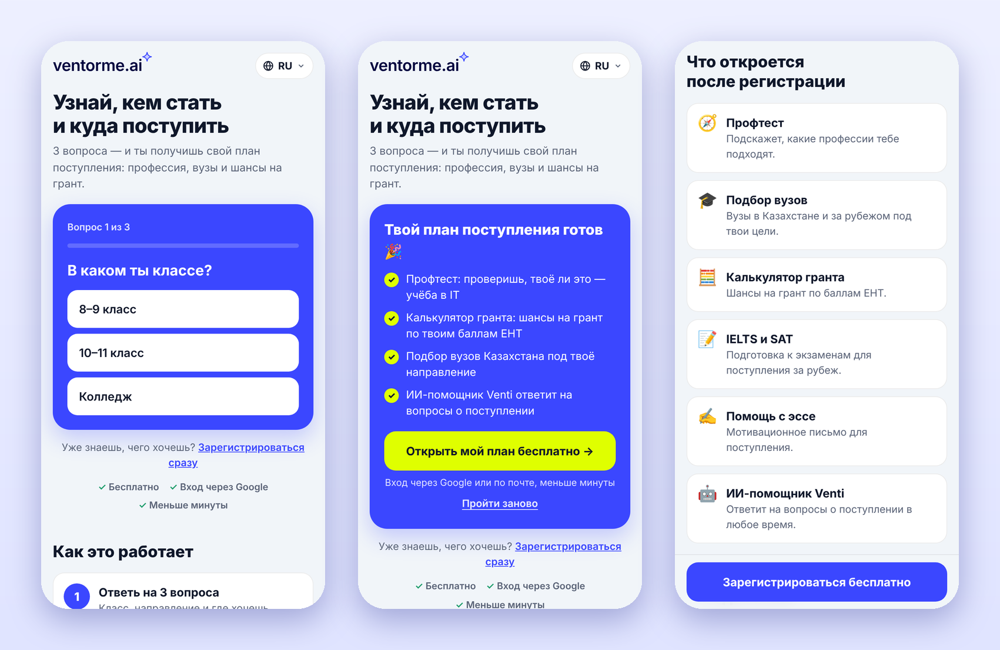
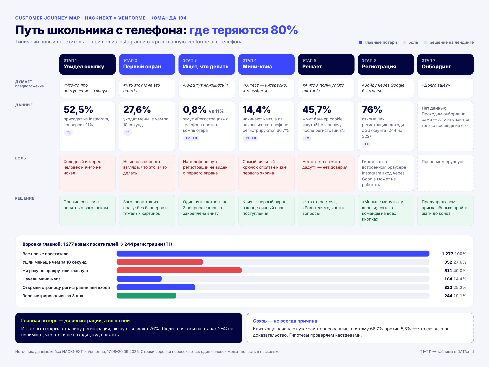

<picture>
  <source media="(prefers-color-scheme: dark)" srcset="logo-dark.svg">
  
</picture>

### Лендинг, который превращает посетителей в регистрации

Три вопроса — и школьник получает свой план поступления: профессия, вузы и шансы на грант.

**[Открыть сайт](https://mickey-hakaton-project.vercel.app/)** · [Проблема](#проблема) · [Путь пользователя](#путь-пользователя) · [Решение](#решение) · [Возможности](#возможности) · [Запуск](#запуск)

 

 

## Проблема

Больше **80%** новых посетителей главной [ventorme.ai](https://ventorme.ai) уходят, не зарегистрировавшись. Мы разобрали 11 таблиц с данными о 1 277 посетителях и нашли, где именно они теряются.

> [!NOTE]
> Т1–Т11 — номера таблиц из данных кейса. Все таблицы собраны в [DATA.md](DATA.md), номер в таблице ниже ведёт прямо на нужную.

| Что показали данные | Где |
|:--|:--:|
| 80% посетителей заходят с телефона, но кнопку «Регистрация» там нажимают 0,8% посетителей против 11% на компьютере | [Т2](DATA.md#t2), [Т9](DATA.md#t9) |
| Мини-квиз начинают только 14,4%, а из начавших на телефоне регистрируются 66,7% | [Т1](DATA.md#t1), [Т8](DATA.md#t8) |
| Люди ищут ответы сами: «Что я получу после регистрации?», «Родителям», «Безопасны ли мои данные?» | [Т9](DATA.md#t9) |
| 30% посетителей с телефона уходят меньше чем за 10 секунд | [Т7](DATA.md#t7) |

## Путь пользователя

*Customer Journey Map*

Мы разложили путь типичного посетителя — школьника, который пришёл из Instagram с телефона, — на 7 этапов и отметили, где он теряется и что мы изменили.

## Решение

| Было на главной | Стало на лендинге |
|:--|:--|
| Путь к регистрации на телефоне не виден с первого экрана | Квиз и ссылка на регистрацию на первом экране, кнопка закреплена внизу при прокрутке |
| Квиз спрятан ниже первого экрана | Квиз — главный элемент страницы и в конце показывает персональный план |
| Непонятно, что дадут после регистрации | Блок «Что откроется после регистрации», раздел для родителей, частые вопросы |
| Тяжёлая страница | Один файл без картинок и библиотек — открывается мгновенно даже на мобильном интернете |

## Возможности

- **Квиз из трёх вопросов** — класс, направление, где учиться. План в конце собирается под ответы: для гранта в Казахстане — калькулятор ЕНТ, для учёбы за рубежом — IELTS, SAT и эссе.
- **Три языка** — русский, казахский и английский. Язык выбирается по настройкам браузера, его можно сменить в шапке или передать ссылкой: `?lang=kk`, `?lang=en`.
- **Удобно с телефона** — крупные кнопки, текст читается без увеличения, ничего не уезжает за край экрана от 320 px.
- **Красивое превью ссылки** — в Telegram, WhatsApp и Instagram показываются заголовок и описание.
- **Все кнопки ведут на ссылку команды** — `ventorme.ai/register?utm_source=hacknext&utm_campaign=team-104`.

## Запуск

Сайт — это один файл `index.html`: ни установки, ни сборки. Скачайте репозиторий и откройте файл в браузере.

Продакшен развёрнут на Vercel и обновляется автоматически после каждого пуша в `main`.

 

Команда 104 · HACKNEXT × Ventorme · октябрь 2026

